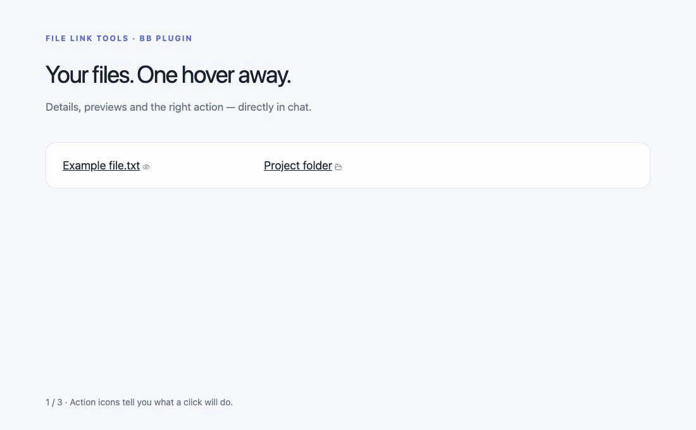
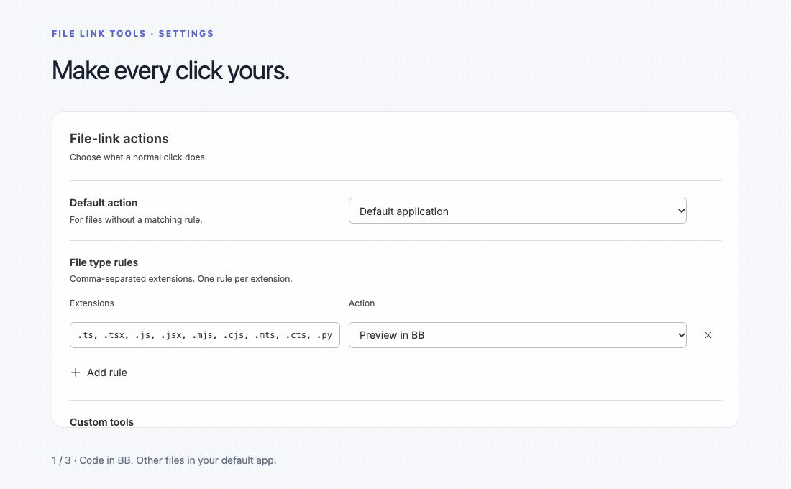

# File Link Tools

**Useful actions for every file link in BB.**

See file details without leaving the conversation. Preview code in BB, reveal files in their folder, or open them with the app you choose.



## A small card. The actions you need.

- **Hover for details.** File size, a one-line path and small image or text previews.
- **Peek into folders.** Immediate file and subfolder counts, without a recursive scan.
- **Know what a click does.** Each link’s icon reflects its configured action.
- **Keep familiar controls.** Copy the name or path beside it; use BB’s own application menu.
- **Use touch or a keyboard.** Long press opens the card. Down Arrow enters its actions; Escape closes it.

## Make every click yours

Start with sensible defaults:

| File type | Normal click |
| --- | --- |
| Common code, configuration and text extensions | Preview in BB’s side panel |
| Other files, including media and documents | Open with the system’s default application |
| Folders | Open in the file manager |

Change these in **Settings → File Link Tools**. Extension rules override the default. Add your own tools with a name, icon and command, then try a filename to check which rule wins.



For example, a VS Code tool can use:

```text
code --goto "{path}:{line}:{column}"
```

Commands run without a shell. BB supplies the native application menu; the plugin does not maintain a separate app list.

## Install

Requires **BB 0.47+** and **Node.js 22.6+**.

```sh
bb plugin install https://github.com/linniksa/bb-plugin-file-link-tools
```

Open **Settings → File Link Tools** to customize it. Turn off **Use configured file-link actions** to let BB handle normal clicks again.

## Ask your agent

“Open Python files in BB” or “Use my editor for TypeScript.” Agents can change the same settings through the plugin CLI:

```sh
bb file-link-tools settings show
bb file-link-tools settings rule set .py,.ts,.tsx preview
bb file-link-tools --help
```

## Good to know

- Cards and click overrides require a confirmed existing file or folder. Other links retain BB’s handling.
- Inline previews are for small images and text. Video has no inline player; open it with the default application or BB’s viewer.
- File operations require a local thread on BB’s primary host. macOS has been exercised; native Windows and Linux GUI behavior remains unverified. WSL is not supported.
- English, Simplified Chinese, Korean, Japanese, Spanish and Russian are selected automatically from the browser locale.

The animations show the actual plugin in BB, with English UI and example links. The custom-tool example is an unsaved settings draft.

[Development, preview limits and platform details](docs/reference.md) · [Agent instructions](skills/file-link-tools/SKILL.md)
